# Gummy Studio

Gummy Studio is the visual builder for [Gummy UI](../../README.md). You drag components onto a page, fill in their settings in a side panel, wire them to API endpoints, and the studio produces the three plain-object configs the Gummy UI engine renders: **model**, **api** and **container**. No JSX is written in the studio; the export is handed to a developer who drops it into an app.

This guide is for people who build screens in the studio. It walks through the workspace once, then explains how to configure each kind of component, with screenshots of the real panels. Developers maintaining the studio should start from [For developers](#for-developers).

> Every screenshot below was taken against the seeded **Country manager** demo project with the mock API running, so what you see on a fresh install matches the pictures.

## Table of contents

- [Getting started](#getting-started)
- [A tour of the studio](#a-tour-of-the-studio)
  1. [Portal and projects](#1-portal-and-projects)
  2. [Shared library: APIs and models](#2-shared-library-apis-and-models)
  3. [Pages](#3-pages)
  4. [The canvas](#4-the-canvas)
  5. [The inspector: Layout, Props, Code](#5-the-inspector-layout-props-code)
  6. [Page data](#6-page-data)
  7. [Menu and app shell](#7-menu-and-app-shell)
  8. [Theme and environment](#8-theme-and-environment)
  9. [Live Preview, Overview and Export](#9-live-preview-overview-and-export)
- [Configuring components](#configuring-components)
  - [What every Props panel has](#what-every-props-panel-has)
  - [Inputs](#inputs)
  - [Date and time](#date-and-time)
  - [Upload](#upload)
  - [Data: the Data Table in depth](#data-the-data-table-in-depth)
  - [Data: Form List and Repeater](#data-form-list-and-repeater)
  - [Display](#display)
  - [Layout](#layout)
  - [Overlay](#overlay)
  - [Utility: the Button](#utility-the-button)
- [For developers](#for-developers)

---

## Getting started

### Prerequisites

- [Bun](https://bun.sh/)
- Node.js **20 or newer** (the studio runs on Vite 8)
- A browser. The studio keeps your whole workspace in that browser's `localStorage`.

### Run it

From the repository root:

```bash
bun install
```

Build the component library once. The studio renders the real library components on its canvas, so it needs the library's `dist/` folder to exist:

```bash
bun run --filter @gummy-ui/ui build
```

Start the mock API (port 9000) and the studio (port 3300) in two terminals:

```bash
bun run api
```

```bash
bun run studio
```

Open <http://localhost:3300>. The portal shows one seeded project, **Country manager**, which already has 24 pages, 28 endpoints and 30 models attached. It is the best place to click around before starting your own project.

### Where your work is saved

Served by the `gummy studio` CLI (`@gummy-ui/cli`: `npx gummy studio` in your app's folder), everything is written to `gummy/` in that folder on every change: `workspace.json` is the studio's own state and `projects/<key>/` is the runtime document each project renders through `<GummyApp>` — `project.json` plus one `pages/<page>.json` per page, which the app loads on the page's first visit. Only the project you edit is re-serialized, only changed files are rewritten, and page files of deleted pages are removed. Commit that folder.

Served any other way (the monorepo's `bun run studio`, a static host), the workspace lives in your browser's localStorage. The **Save to project** button in the topbar (the floppy icon beside the save status) writes the same files out: in Chrome or Edge it asks once for your app's folder (pick the project root or its `gummy/` folder) and writes `gummy/workspace.json` and `gummy/projects/<key>/` into it — shift-click to pick another folder; in other browsers it downloads `workspace.json` and a single-file `<key>.json` per project (every page inline — a browser can't download a folder; the starter renders both forms) for you to drop into `gummy/`. Under the CLI the same button just flushes the pending autosave.

### Troubleshooting

| Symptom | Cause and fix |
|---|---|
| `bun run studio` fails to start, or Vite reports a syntax error in its own files. | Your default `node` is older than 20. Put a Node 20+ on `PATH` first (on macOS with Homebrew: `PATH=/opt/homebrew/bin:$PATH bun run studio`). |
| Vite logs `Failed to resolve import "@gummy-ui/ui"` and keeps logging it after the library finished building. | The library was rebuilt while the studio was running, which briefly removed `dist/` and poisoned Vite's cache. Stop the studio, delete `apps/studio/node_modules/.vite`, start it again. Rebuild the library **before** starting the studio to avoid this. |
| Live Preview shows empty tables or an error line. | The mock API is not running, or the project's `API_URL` variable (Env tab) does not point at it. Start `bun run api` and check the value is `http://localhost:9000`. |
| The Preview button in the topbar is disabled. | The current page has no components yet. Add one. |
| Console warnings about `forwardRef` taking two parameters. | Harmless. The library is built against React 18 and the studio runs React 19. |

---

## A tour of the studio

### 1. Portal and projects

The portal is the first screen. The left rail splits into **Workspace** (your projects) and **Shared library** (APIs, models and templates that every project can use), plus an activity log of who changed what.

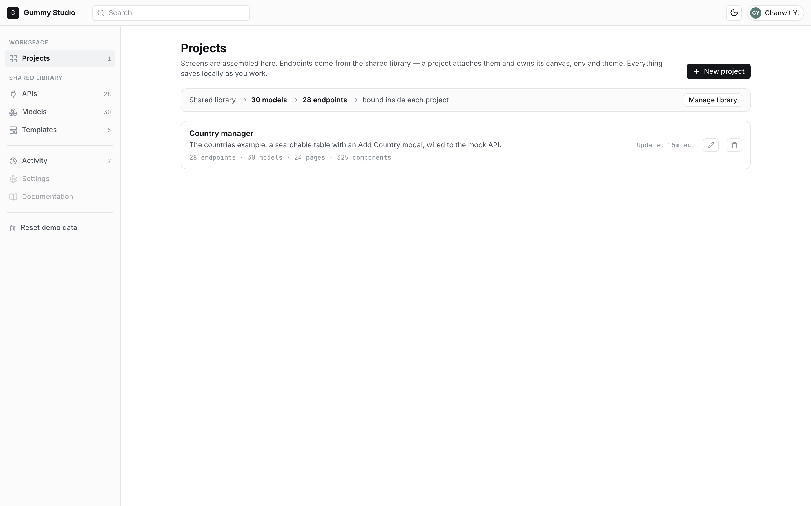

A project owns its **pages** (the canvases), its **environment variables**, its **theme**, its **menu** and the list of library endpoints it has **attached**. Everything else is shared. Click a project card to open it, the pencil to rename it, and **New project** to start an empty one.

### 2. Shared library: APIs and models

Endpoints and models live in the library, not in a project, so two projects can call the same backend without describing it twice.

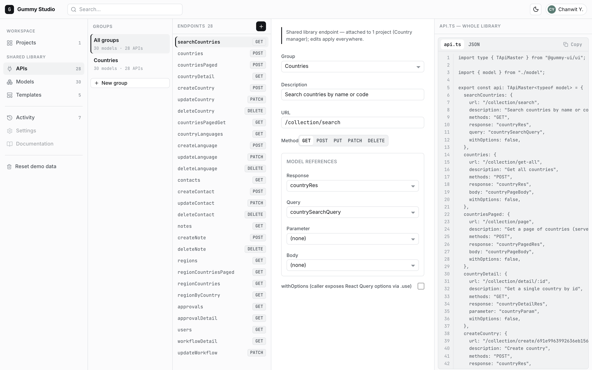

The API editor has three columns: groups, the endpoint list, and the selected endpoint's form. An endpoint is a name, a URL (with `:param` placeholders such as `/collection/detail/:id`), an HTTP method and up to four **model references**: the response, query, parameter and body shapes. Those references are what give every component downstream a list of real field names to pick from. The right pane shows the `api.ts` the library exports.

The **Models** page works the same way: a model is a named shape of fields (`string`, `number`, `boolean`, `any`, nested objects and arrays) that an endpoint can reference.

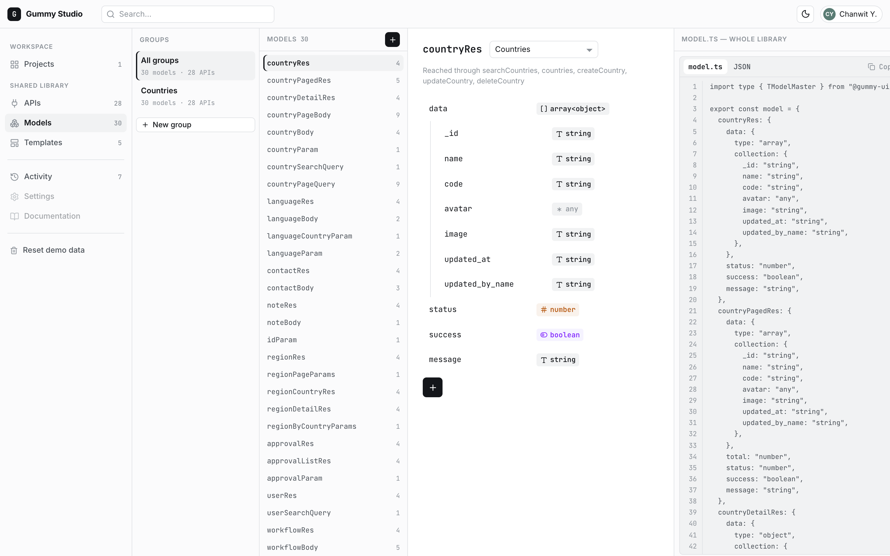

Inside a project, the **APIs** tab (the plug icon in the topbar) shows only the endpoints attached to this project. **Library** opens the picker to attach more, and the **Test run** section at the bottom calls the endpoint for real against the project's `API_URL`, so you can check a URL and its models before wiring a table to it.

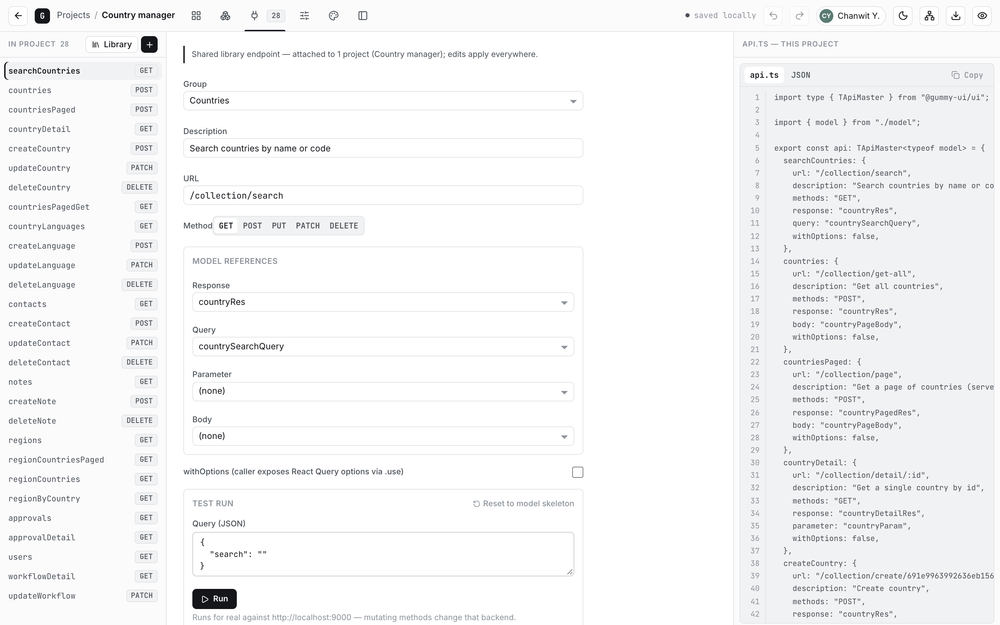

### 3. Pages

A page is one screen of the app: a route and a canvas. The **Pages** tab in the left pane lists them as a tree, with the pages reachable through buttons nested under the page that links to them (the italic `via "Open"` lines). The number on the right is the component count.

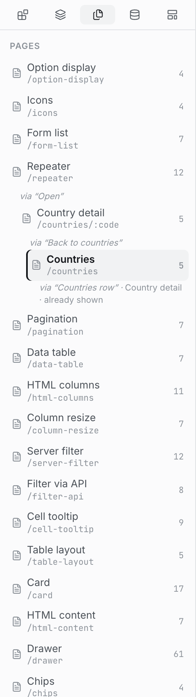

The page controls sit at the head of the canvas bar: the page name (click to rename), its route, and buttons to rename, move earlier or later, delete, and add a page. Creating or renaming opens the page dialog.

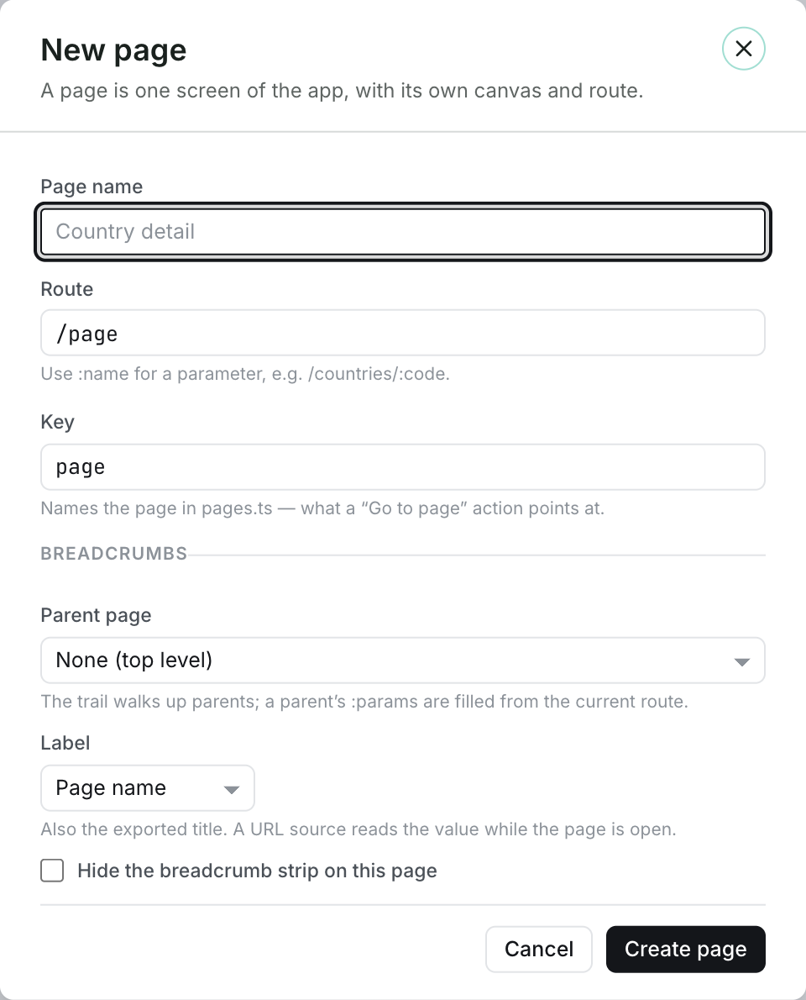

| Field | What it does |
|---|---|
| Page name | The label shown in the studio and, by default, the breadcrumb and browser title. |
| Route | The URL path. Use `:name` for a parameter, for example `/countries/:code`. Components on the page can read it. |
| Key | The page's identifier in the exported `pages.ts`. "Go to page" actions and menu links point at it. Must be unique in the project. |
| Parent page | Builds the breadcrumb trail. A parent's `:params` are filled from the current route. |
| Label | Where the breadcrumb text comes from: the page name, a fixed value, a URL param, a query value or page data. |
| Hide the breadcrumb strip | Switches the strip off for this page only. |

### 4. The canvas

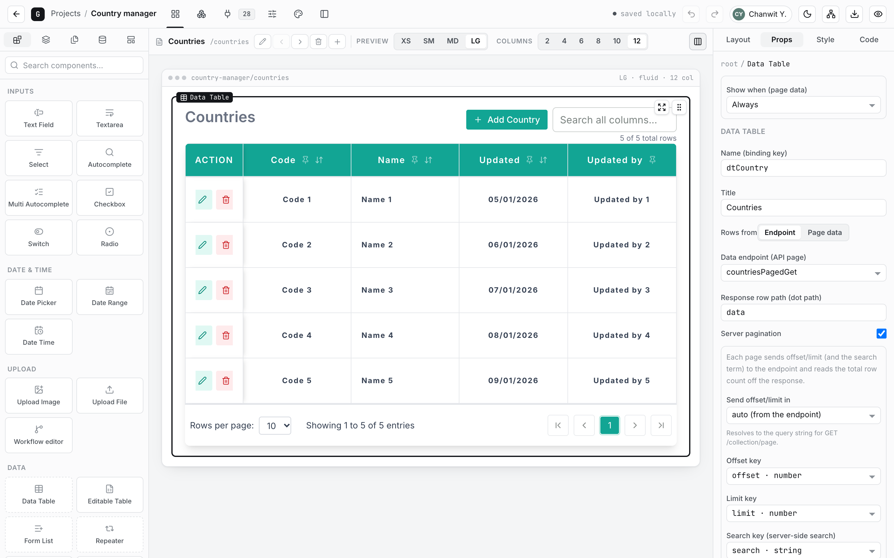

The Layout tab has three areas. The **left pane** holds the component palette and four other tabs. The **canvas** in the middle is the page, drawn at the chosen breakpoint. The **inspector** on the right edits whatever is selected.

**Adding components.** Drag a tile from the palette onto the canvas to insert it at the drop point, or click the tile to append it. Tiles with a dashed border are containers that hold other components. The search box filters the palette.

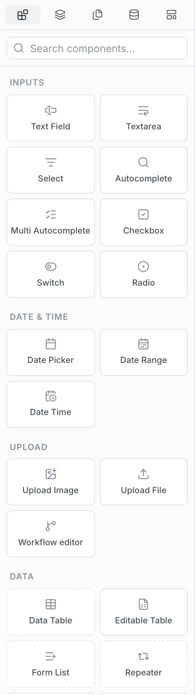

**The canvas bar.** `Preview` switches the frame between XS (375px), SM (640px), MD (768px) and LG (fluid), and `Columns` sets how many grid columns this canvas has at that breakpoint. Every component sits in a grid cell with its own span per breakpoint, which is how one layout adapts to phones and desktops. The toggle on the far right shows dashed column guides.

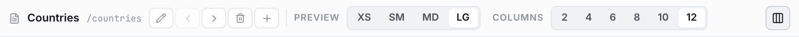

**Selecting and moving.** Click a component to select it (the inspector switches to Props). Drag the grip in its corner to reorder. Click the empty frame to deselect. Undo is `Cmd/Ctrl+Z`, redo `Shift+Cmd/Ctrl+Z`, and both are also in the topbar.

**Layers.** The second tab of the left pane is a tree of the whole page, nested containers included. Click a row to select it.

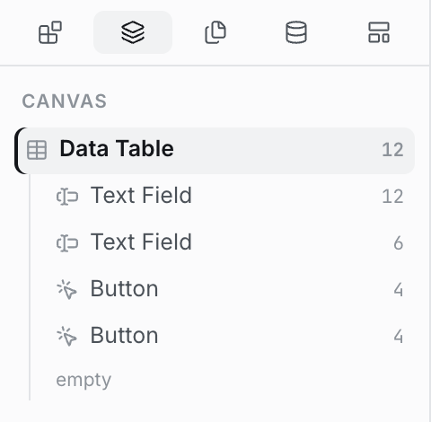

**Drilling into containers.** Containers (Container, Paper, Tab, Card), overlays (Modal, Drawer, Popover) and the data components with a template (Data Table's edit form, Form List's row, Repeater's item) each hold a **child canvas**. You edit it by drilling in: the Props panel has an "Edit contents" style button, and the canvas then shows only that child canvas, with a breadcrumb and a **Main layout** button to get back out. Only one canvas is ever active, so drag and drop, selection and the inspector all work the same way inside.

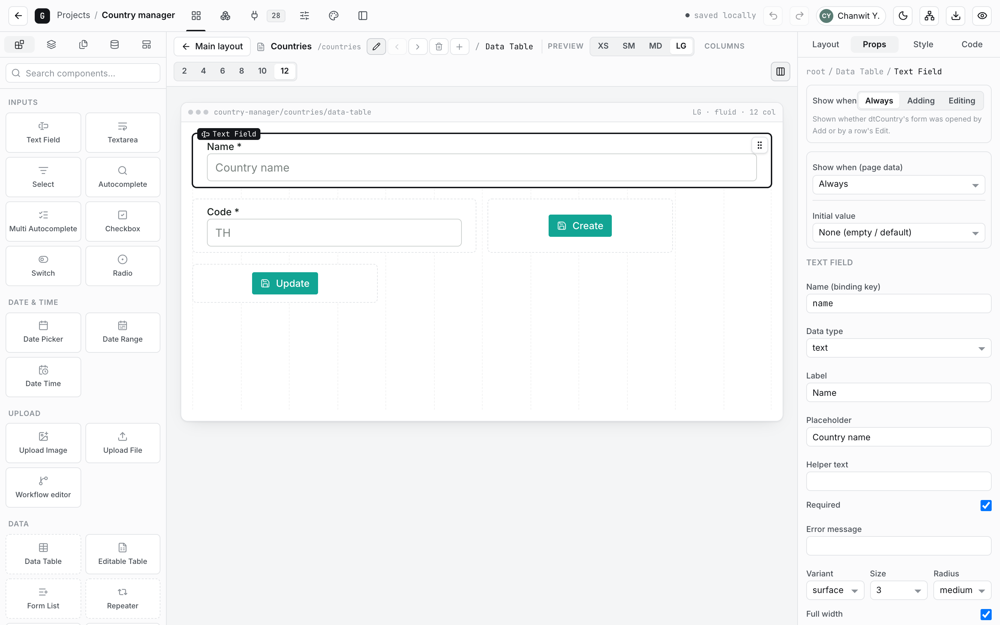

**Templates.** The last left-pane tab lists the library's templates. Inserting one clones its components onto the current canvas with fresh ids.

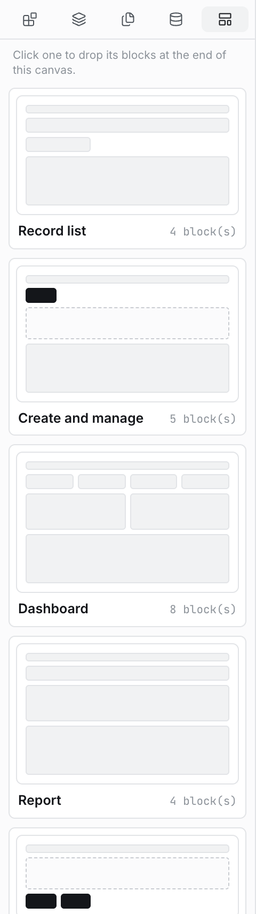

### 5. The inspector: Layout, Props, Code

The right pane has three tabs. The line under them shows where the selected component lives (`root / Data Table / Text Field`); click an ancestor to jump back up.

**Layout** is the grid cell. With a component selected it shows the cell's settings **per breakpoint**: the column span (tap 1 to 12), an explicit column start, the row span, `grid-area`, self-alignment and order. Pick a breakpoint first; a value you set at LG does not change SM. With nothing selected the same tab shows the canvas's own grid: columns, gaps, alignment and auto-flow per breakpoint.

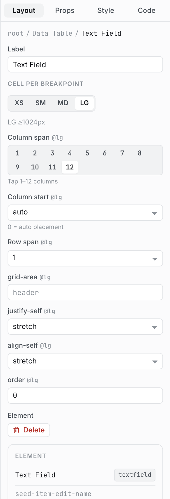

**Props** is the component's configuration. It is different for every type and is what the rest of this guide is about.

**Code** shows the page as the engine will receive it: the **Bins (engine)** JSON and the responsive CSS. It is read-only and always covers the whole page, whichever canvas you are in. This is the quickest way to see what a Props field changes.

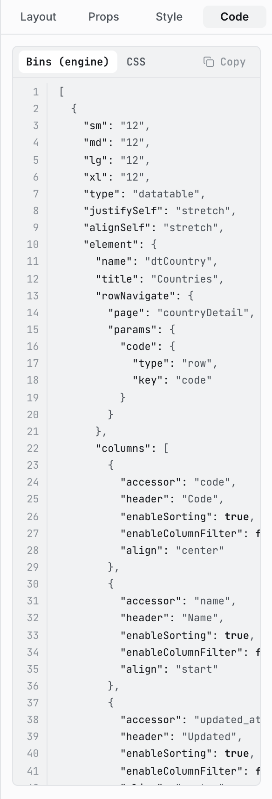

### 6. Page data

Pages can load data once and bind it anywhere on the page. The **Page data** tab in the left pane lists the page's loads and the global loads.

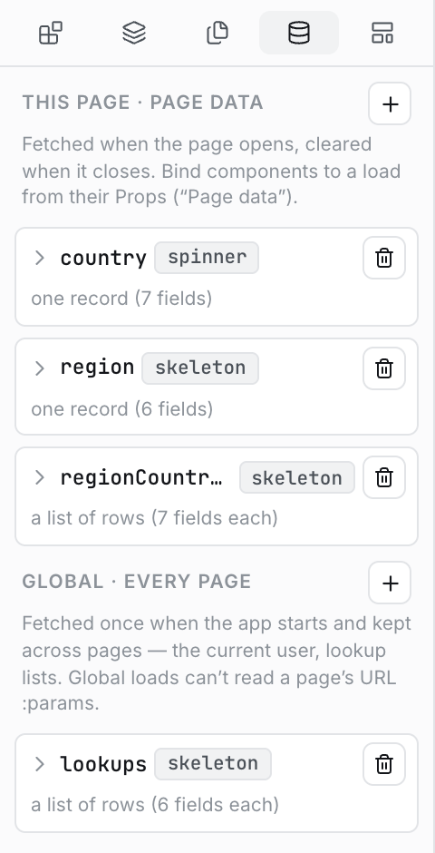

A load is an endpoint plus a key. **This page** loads run when the page opens (and are cleared when it closes). They may read the route's `:params` and each other's results, so `country` can be loaded from the URL and `region` from the country's region id; a load waits until what it reads is available. **Global** loads run once when the app starts and stay available on every page (the current user, lookup lists). They cannot read a page's `:params`.

The tag on each load is its **loading mode**: `skeleton` makes every component bound to it draw a placeholder until the data lands, `spinner` shows the page-wide overlay, and silent shows nothing. Expand a load to change the endpoint, the key and the mode.

Components bind to a load from their Props panel. Any text slot that offers a `Static | Page data` switch, any field's **Initial value**, a table's **Rows from**, a select's option source or a repeater's items can read a load and one of its fields:

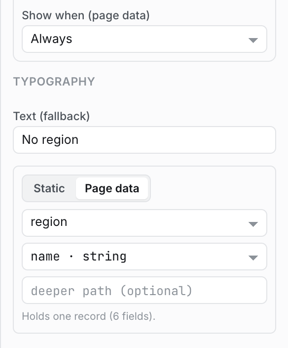

The **Show when (page data)** control at the top of every Props panel hides a component until a load has succeeded, failed, is loading, or a field compares to a value.

### 7. Menu and app shell

The **Menu** tab (the sidebar icon in the topbar) describes the exported app's chrome.

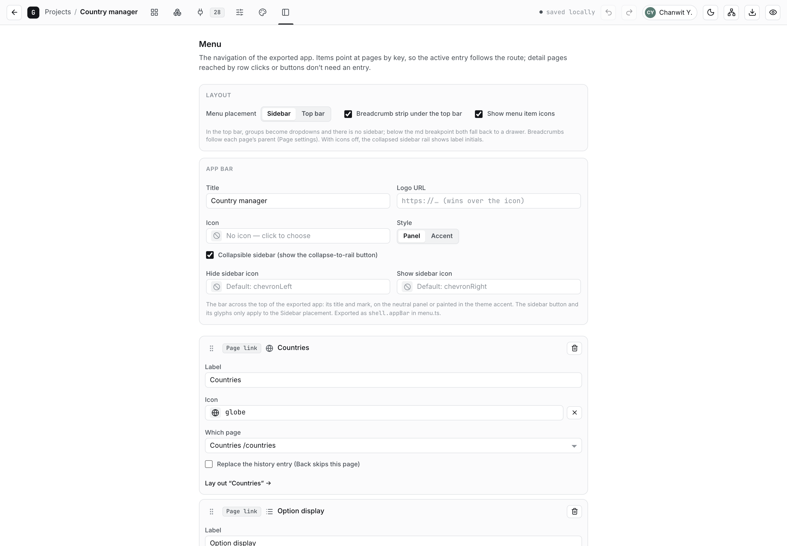

- **Layout**: whether the menu is a sidebar or a strip in the top bar, whether a breadcrumb strip appears under the top bar, and whether items show icons.
- **App bar**: the title, an icon or logo, a `Panel` or `Accent` style, and whether the sidebar can collapse to an icon rail (with custom glyphs for the collapse button).
- **Items**: sortable cards. A **Page link** points at a page by key, with a label, an icon and the values for the page's `:params`. Groups nest links one level deep, external links open URLs, and dividers separate sections. Detail pages reached through row clicks or buttons do not need an entry.

The result is exported as `menu.ts`, which the app's `AppShell` takes as is.

### 8. Theme and environment

The **Theme** tab is the app-wide `ThemeProvider` config and applies live to the canvas and the Live Preview.

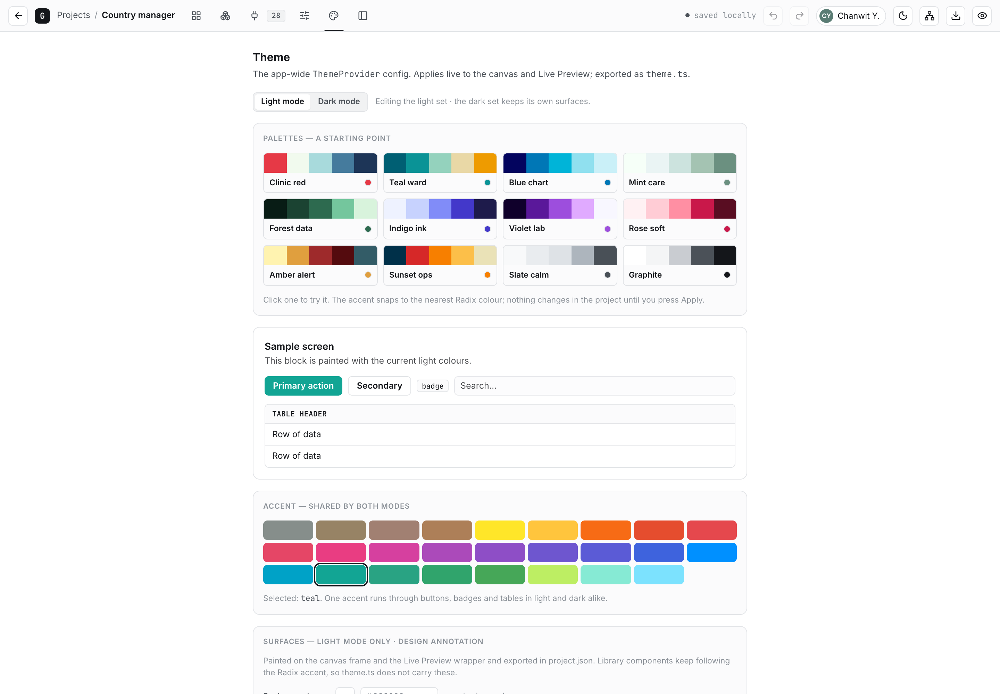

Start from a palette, then set the **accent** (the Radix colour used by buttons, badges and table headers in both light and dark mode), the radius, panel background, density and font, button colour, and the data table's header font and its eight colour roles. The light and dark sets each have their own surfaces. The topbar's moon/sun button flips the studio and the canvas together.

The **Env** tab holds the project's environment variables. They are exported as a Vite `.env` with the `VITE_` prefix. `API_URL` is special: it is also the base URL the Live Preview and the API test runner call, so it must point at a running backend.

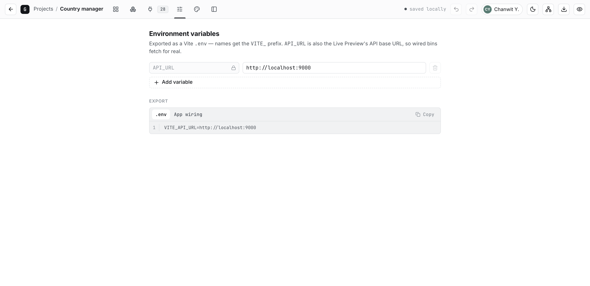

Below the variables, **Custom actions** is the list of functions the app's developer will code and hand to the library's `<ActionsProvider>`. The studio only knows their *names*: declare one here (a JS identifier, with an optional description), and it appears in every button's `+ Add action…` list as `Custom: name`. The export's `actions.ts` carries a typed stub per declared name, ready to fill in — see [Utility: the Button](#utility-the-button) for the chain side.

### 9. Live Preview, Overview and Export

The eye button in the topbar opens the **Live Preview**: the library's own `<GummyApp>` rendering the project document exactly as the app will, inside the real app shell, against the project's `API_URL`. Tables fetch, forms validate and submit, modals open, navigation works.

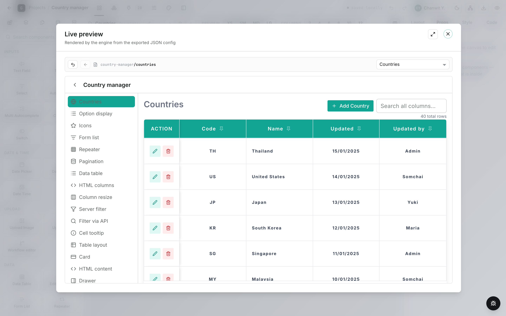

The bar at the top shows the current route, a back button, one input per `:param` of the current page, and a page selector. The bug icon in the bottom corner opens the **dev tools**: the form values, the engine's context data, every page-data slice with its status, the engine stores, a log of API calls with their responses, and the Bins JSON.

The network icon opens the **Overview**, a map of every page with the jumps between them (row clicks, buttons, menu links) and the endpoints each page uses. Click a card to open that page.

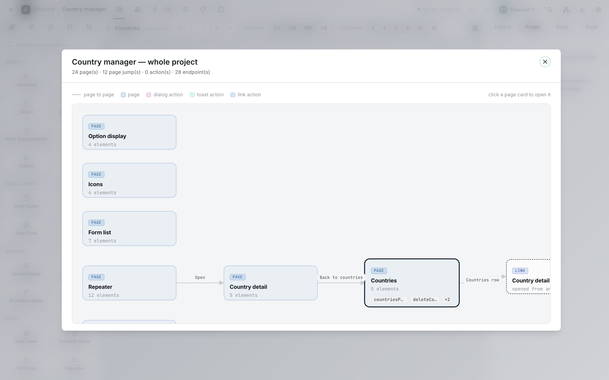

The download icon opens **Export**: the project document the engine renders, plus the stubs for the code only the app can supply. **Export to project** writes the whole bundle into your app's `gummy/` folder — `projects/<key>/` where `<GummyApp>` reads it, `actions.ts` / `components.tsx` / `HANDOFF.md` beside it, never into `src/` — through the `gummy studio` CLI when the studio runs under it, else the folder picker (Chrome / Edge; shift-click to pick another folder) or downloads. **Download all** saves the files to your downloads folder instead.

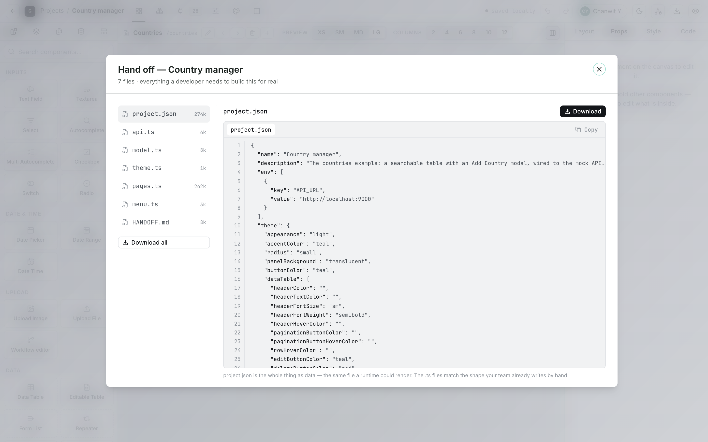

| File | Contents |
|---|---|
| `<key>.json` | The whole project as data (`schemaVersion: 1`): env, model, api, pages, menu, shell, theme, global loads, the names of the custom actions and components. `<GummyApp project={…}>` renders it. |
| `actions.ts` | Typed stubs for the custom actions declared on the Env page (only when there are any). |
| `components.tsx` | Typed stubs for the custom components declared on the Env page (only when there are any). |
| `HANDOFF.md` | How to mount it (`<GummyApp>` inside the app's router), every page with its route, params, data and actions, the endpoints and the environment. |

The files match the shape a developer would otherwise write by hand (see the root [README](../../README.md#the-declarative-engine)), so the handoff is `pages.ts` + `menu.ts` dropped into `AppShell` / `PageRouter`.

---

## Configuring components

The palette has ten groups. The sections below take one representative component per group, show its Props panel, list what each field does, and show the Bin it becomes in the Code tab. Siblings are described by what they add. The Data Table gets its own, longer section.

### What every Props panel has

Three things are shared by every component:

- **The path line** (`root / Data Table / Button`) and, under it, **Show when (page data)** and, for form fields, **Initial value**. See [Page data](#6-page-data).
- Inside a Data Table's edit form, a second **Show when** with `Always | Adding | Editing`. The same form serves the table's Add button and its Edit buttons; this is how a Create button appears only when adding and an Update button only when editing.

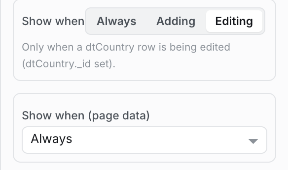

- **Bindings.** Where a value can come from data instead of being typed, the panel shows a switch: `Static | Page data`, and inside a Repeater's item template also `Item field`. Static is the fallback when the bound value is empty.

A component's **Name** is its key in the form (for inputs) or its registry key (for tables, lists and repeaters). It is what buttons refer to when they reload a table and what the backend receives, so keep it unique on the page.

### Inputs

Text Field, Textarea, Select, Autocomplete, Multi Autocomplete, Checkbox, Switch and Radio are all **form fields**: they have a name, a label, a required flag and an error message, and they are collected by the Save button of the form they sit in.

#### Text Field

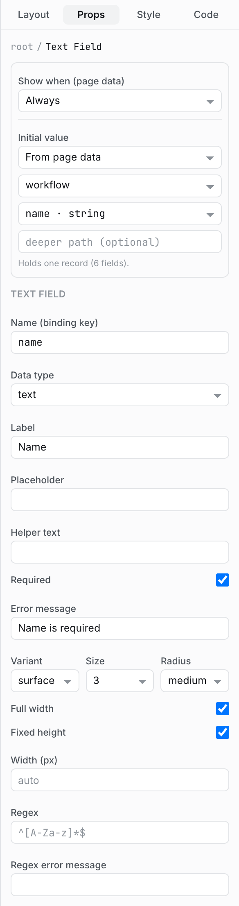

| Field | What it does | Default |
|---|---|---|
| Name (binding key) | The field's key in the submitted form. | `textfield_n` |
| Data type | The input type: text, number, email, password, tel, url, search, date, time, hidden… | text |
| Label, Placeholder, Helper text | What is shown around the input. | empty |
| Required, Error message | Validation; the message is shown when the field is empty on submit. | off |
| Variant, Size, Radius | Radix look: `classic | surface | soft`, size 1 to 3, radius. | surface, 2, medium |
| Full width, Fixed height, Width (px) | Sizing inside the cell. | on, on, auto |
| Regex, Regex error message | A pattern the value must match, and its message. | none |

The Workflow editor page's **Name** field, with its initial value bound to the `workflow` load, exports as:

```json
{
  "sm": "12", "md": "6", "lg": "6", "xl": "6",
  "type": "textfield",
  "element": {
    "name": "name",
    "dataType": "string",
    "label": "Name",
    "isRequired": true,
    "errorMessage": "Name is required",
    "variant": "surface", "size": "3", "radius": "medium",
    "isFullWidth": true, "isFixedHeight": true,
    "value": { "type": "state", "key": "workflow", "path": "name" }
  }
}
```

The four span keys are the Layout tab; everything under `element` is the Props panel.

#### Select, Autocomplete and Multi Autocomplete

The three share one panel. On top of the common field settings they have an **Options source** and an **Option display** section.

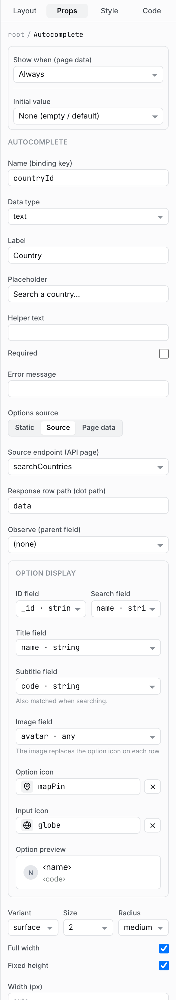

| Field | What it does |
|---|---|
| Options source | `Static` (type the options as JSON), `Source` (an endpoint) or `Page data` (a load's array). |
| Source endpoint, Response row path | The endpoint, and the dot path to the array of rows in its response (`data`). |
| Observe (parent field) | Makes this field depend on another select on the page: it refetches with the parent's value and clears when the parent changes. |
| ID field, Search field, Title field | Which row fields are the stored value, the text that is searched, and the row's title. Picked from the endpoint's response model. |
| Subtitle field, Image field | Optional second line and avatar on each option row (the image replaces the option icon). |
| Option icon, Input icon | A glyph on every row, and one in the trigger. |
| Option preview | A live row drawn with the current keys. |

A Multi Autocomplete adds a maximum number of selections and shows its picks as chips. Its stored value is the list of ids.

```json
{
  "type": "autocomplete",
  "element": {
    "name": "countryId",
    "dataType": "string",
    "label": "Country",
    "keys": { "id": "_id", "search": "name", "display": "name" },
    "options": [],
    "placeholder": "Search a country…",
    "inputIcon": "globe",
    "itemIcon": "mapPin",
    "itemSubtitle": "code",
    "itemAvatar": "avatar",
    "api": { "name": "searchCountries", "paths": ["data"] }
  }
}
```

#### Checkbox, Switch and Radio

A **Checkbox** and a **Switch** are one boolean each. For both, **Required** means the box must be ticked (the switch must be on). The Switch adds a label position, a default state, a disabled flag, Radix size and variant, and **Enabled when**: pick another switch on the page and whether it must be on or off. The gate switch exports with `canObserve: true` and the gated one with an `enabledWhen` condition.

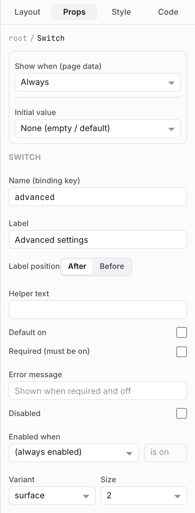

A **Radio** is a single choice from static options, laid out horizontally or vertically, with an optional preselected value. A **Textarea** is a multi-line Text Field with a row count, a resize mode, auto-resize, a maximum length and a character counter.

### Date and time

Date Picker, Date Range and Date Time share one panel.

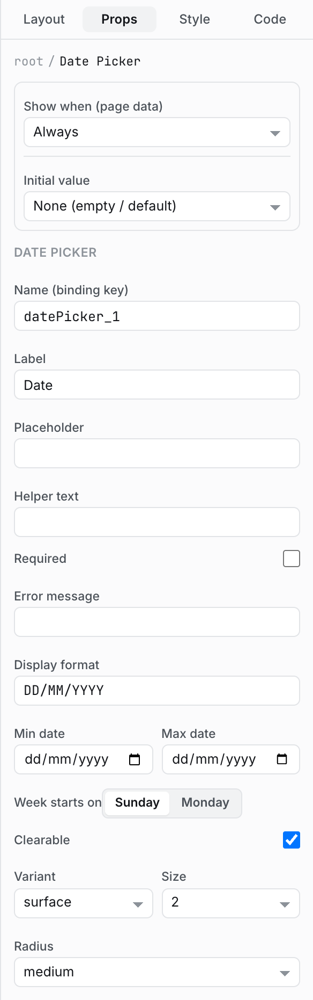

| Field | What it does | Default |
|---|---|---|
| Display format | A dayjs format for the input text. | `DD/MM/YYYY` |
| Min date, Max date | Bounds for the calendar. | none |
| Week starts on | Sunday or Monday. | Sunday |
| Clearable | Shows a clear button. | on |
| Variant, Size, Radius | Radix look. | surface, 2, medium |

Date Range stores two dates; Date Time adds a time picker.

```json
{
  "type": "datepicker",
  "element": {
    "name": "startDate",
    "dataType": "string",
    "label": "Start date",
    "isRequired": true,
    "errorMessage": "Pick a date",
    "variant": "surface", "size": "2", "radius": "medium",
    "clearable": true,
    "displayFormat": "DD/MM/YYYY",
    "weekStartsOn": 0
  }
}
```

### Upload

**Upload File** is the general uploader; **Upload Image** is the single hero-image picker with a preview. The **Workflow editor** also lives in this group and is described at the end.

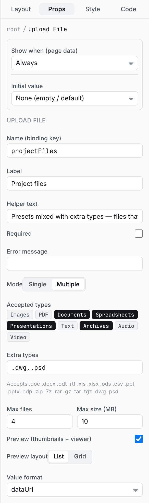

| Field | What it does | Default |
|---|---|---|
| Mode | `Single` (the dropzone becomes the file, with Replace and Remove) or `Multiple`. | Single |
| Accepted types | Preset chips (Images, PDF, Documents, Spreadsheets, Presentations, Text, Archives, Audio, Video) plus **Extra types** for raw extensions or MIME types. The line under them lists what is accepted. | all |
| Max files, Max size (MB) | Limits. Files that break a limit are skipped and named in the error line; the rest are kept. | none |
| Preview, Preview layout | Thumbnails and a viewer (image, PDF, video, audio, text), as a list or a grid. | on, list |
| Value format | What the form stores per file: a data URL, base64, raw bytes, or `api` (the file is POSTed to the upload endpoint and its response stored). | dataUrl |

```json
{
  "type": "uploadfile",
  "element": {
    "name": "projectFiles",
    "dataType": "any",
    "label": "Project files",
    "multiple": true,
    "valueFormat": "dataUrl",
    "accept": ["document", "spreadsheet", "presentation", "archive", ".dwg", ".psd"],
    "maxFiles": 4,
    "maxSizeMB": 10
  }
}
```

**Workflow editor** is a form field whose value is one approval line: a chain of steps, each with a role and the people in charge. Its panel defines the **Roles** (with "at most" counts and whether a role is pinned first or last), the **Users** endpoint and the row fields that give a user's id, name, job title, image and search text, the **saved step fields** (the key names your backend uses for role, sequence, in-charge users and CC users), the rules (minimum people per step, whether a person may be on several steps) and every label in the dialog.

### Data: the Data Table in depth

The Data Table is the biggest panel, so it is covered section by section. The example is the Countries table of the seeded project.

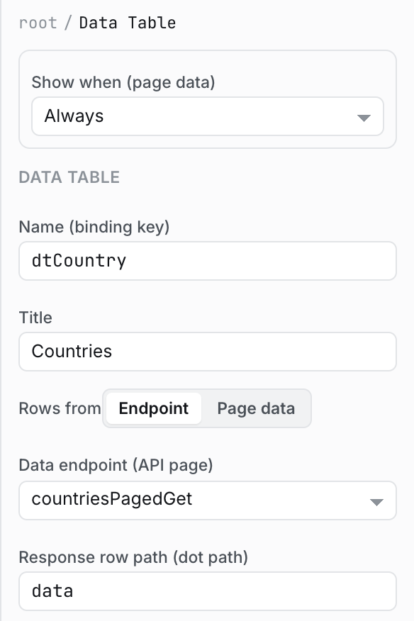

| Field | What it does |
|---|---|
| Name (binding key) | The table's registry key. Buttons reload it by this name, and the edit form's values are read under it. |
| Title | The heading in the table header. |
| Rows from | `Endpoint` (the table fetches) or `Page data` (an in-memory array from a load; paging, sort and filters are then off). |
| Data endpoint, Response row path | The endpoint and the dot path to the row array in its response. |

#### Columns

Each column card has the accessor (the row field) and the header text. **More** opens the column's full settings:

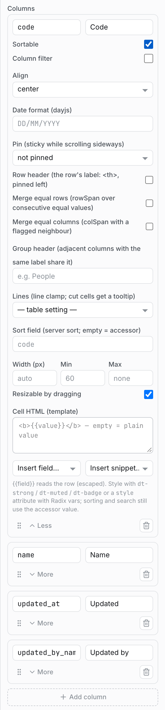

| Field | What it does |
|---|---|
| Sortable, Column filter | The header's sort toggle and per-column filter box. |
| Align, Date format | Cell alignment; a dayjs format for date values. |
| Pin | Sticky left or right while scrolling sideways. Users can also pin left for the session from the header. |
| Row header | Makes this the row's label column (`<th>`, tinted, pinned left). One per table. |
| Merge equal rows / columns | Consecutive equal values become one spanned cell. |
| Group header | Adjacent columns with the same text share a band above them. |
| Lines | Line clamp for this column; cut cells show their whole text in a tooltip. |
| Sort field | The key sent for server sort when it differs from the accessor. |
| Width, Min, Max, Resizable by dragging | Column sizing in pixels and whether the user can drag the edge. |
| Cell HTML | A template rendered instead of the plain value: `{{value}}` is this column, `{{field}}` any row field, every value escaped. **Insert field** and **Insert snippet** help; the sanitiser strips scripts and styles. |

Drag the grip to reorder columns; **Add column** appends one.

#### Row click, Add, Edit and Delete

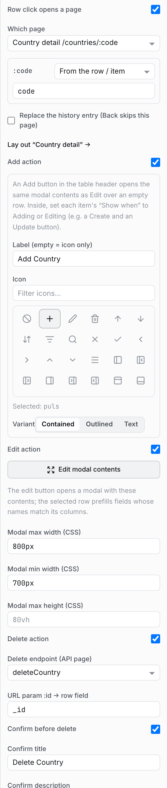

- **Row click opens a page**: pick a page and say where each `:param` comes from (the clicked row, a fixed value, the URL or page data). **Lay out "…"** jumps to that page.
- **Add action**: an Add button in the table header, with its label, icon and variant.
- **Edit action**: an edit button on every row. **Edit modal contents** drills into the table's own child canvas, the form that both Add and Edit open; the clicked row prefills fields whose names match its columns. The modal's width and height limits are here too.
- **Delete action**: a delete button on every row, calling the chosen endpoint with a row field mapped to its URL `:param`, optionally behind a confirm dialog, then reloading the table and showing a snackbar.

Inside the edit form, give each button a **Show when** of `Adding` or `Editing` so the same form carries a Create and an Update button (see [the drill-in screenshot](#4-the-canvas)).

#### Server pagination and sort

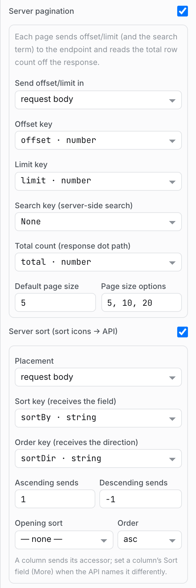

With **Server pagination** on, every page turn sends an offset and a limit to the endpoint and reads the total from the response. **Send offset/limit in** chooses the query string or the request body; `auto` follows the endpoint (an endpoint with a body model pages through its body). The keys are picked from the endpoint's query or body model, the total from the response model.

**Server sort** sends the sorted column and its direction under two keys. **Ascending sends / Descending sends** are what the direction is encoded as (`asc`/`desc` or `1`/`-1`), and **Opening sort** is the sort the table starts with.

#### Server filters and the request mapping

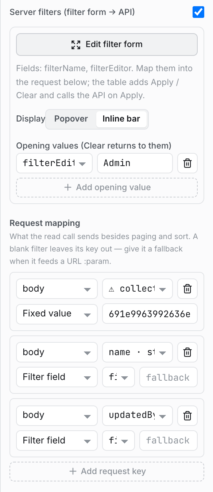

**Server filters** gives the table its own filter form: a second child canvas with ordinary input fields. **Edit filter form** drills into it.

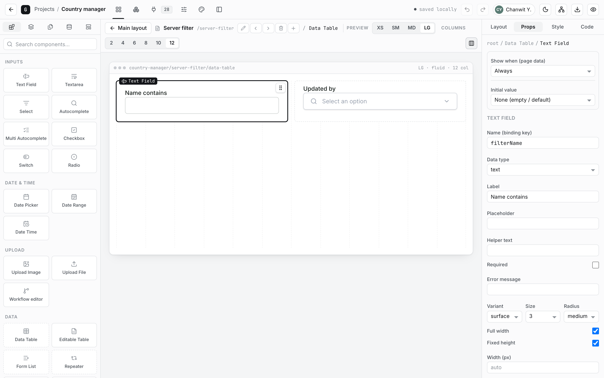

The table draws **Apply** and **Clear** itself and calls the API only on Apply. **Display** puts the form in a popover behind a Filter button or in a bar above the table. **Opening values** are the filters the table starts with (Clear returns to them).

The **Request mapping** says what the read call sends besides paging and sort. Each row is a request part (`query`, `body` or a URL `:param`), a key from the endpoint's model, and a source: a **Filter field** from the form, a fixed value, the current URL or global state. A blank filter leaves its key out of the request, so give a filter that feeds a URL `:param` a **fallback**. Rows for the endpoint's `:params` are seeded when you pick it.

#### Other table settings

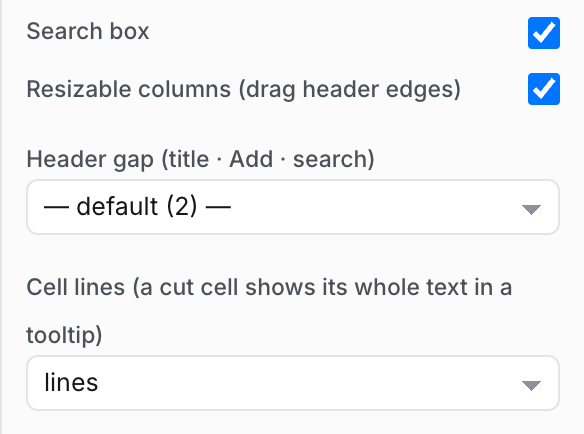

| Field | What it does | Default |
|---|---|---|
| Search box | The "Search all columns" box in the header. With server pagination it needs a **Search key**. | on |
| Resizable columns | Drag handles on every header edge. | on |
| Header gap | Spacing between the title, the Add button and the search box. | 2 |
| Cell lines | The default line clamp for every plain cell; `no clamp` wraps freely. Cut cells get a tooltip. | 2 |

#### What it exports

The Countries table, with its canvases elided:

```json
{
  "type": "datatable",
  "element": {
    "name": "dtCountry",
    "title": "Countries",
    "rowNavigate": { "page": "countryDetail", "params": { "code": { "type": "row", "key": "code" } } },
    "columns": [
      { "accessor": "code", "header": "Code", "enableSorting": true, "align": "center" },
      { "accessor": "name", "header": "Name", "enableSorting": true, "align": "start" },
      { "accessor": "updated_at", "header": "Updated", "enableSorting": true, "useDateFormat": "DD/MM/YYYY" },
      { "accessor": "updated_by_name", "header": "Updated by", "enableSorting": false }
    ],
    "api": {
      "name": "countriesPagedGet",
      "paths": ["data"],
      "pagination": { "offsetKey": "offset", "limitKey": "limit", "searchKey": "search", "totalPath": ["total"], "pageSizeOptions": [5, 10, 20] }
    },
    "canAdd": true,
    "addButton": { "label": "Add Country" },
    "modalContainer": "…the edit form canvas…",
    "modalMaxWidth": "800px",
    "apiDeleteInfo": {
      "name": "deleteCountry",
      "params": { "id": "_id" },
      "confirmBox": { "title": "Delete Country", "description": "Are you sure you want to delete this country?" },
      "isReload": true,
      "snackbarSuccess": { "type": "success", "message": "Country deleted successfully" }
    },
    "canEdit": true,
    "canDelete": true
  }
}
```

And the server-filter table's `api` block, showing where the filter form's fields land:

```json
"api": {
  "name": "countriesPaged",
  "paths": ["data"],
  "body": {
    "collectionId": { "type": "value", "value": "691e9963992636eb1560eadb" },
    "name": { "type": "filter", "key": "filterName" },
    "updatedBy": { "type": "filter", "key": "filterEditor" }
  },
  "pagination": { "placement": "body", "offsetKey": "offset", "limitKey": "limit", "totalPath": ["total"], "defaultPageSize": 5 },
  "sort": { "placement": "body", "sortKey": "sortBy", "orderKey": "sortDir", "orderValues": { "asc": 1, "desc": -1 } }
},
"filterContainer": "…the filter form canvas…",
"filterDisplay": "inline",
"filterDefaults": { "filterEditor": "Admin" }
```

#### Editable Table

The **Editable Table** shares the column cards (header, align, date format, row header, group header, sizing) but edits rows inline with Save and Cancel instead of a modal. Its read paths are its own, and it has no server paging, filters or HTML columns.

### Data: Form List and Repeater

#### Form List

A repeating form over a CRUD API: one row per record, each row its own form with the fields of the **row template**, and Save, Remove and Add drawn by the list itself.

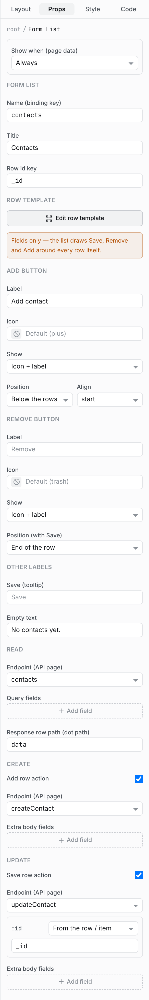

| Section | What it does |
|---|---|
| Name, Title, Row id key | Registry key, heading, and the row field that identifies a record (`_id`). |
| Row template | **Edit row template** drills into the child canvas. Fields only; the chrome is the list's. |
| Add button, Remove button | Label, icon, whether to show icon, label or both, position and alignment. |
| Other labels | The Save tooltip and the empty-list text. |
| Read | The endpoint, optional query fields and the row path. |
| Create, Update, Delete | One endpoint each. A row field maps to the URL `:param` (`:id` from the row's `_id`), extra body fields can be added, and Delete can ask first. Leaving one off removes that ability: no Create means no Add button, no Update makes rows read-only. |

```json
{
  "type": "formlist",
  "element": {
    "name": "contacts",
    "title": "Contacts",
    "addLabel": "Add contact",
    "emptyText": "No contacts yet.",
    "idKey": "_id",
    "rowContainer": "…the row canvas…",
    "apiCrud": {
      "read":   { "name": "contacts", "paths": ["data"] },
      "create": { "name": "createContact" },
      "update": { "name": "updateContact", "params": { "id": "_id" } },
      "delete": { "name": "deleteContact", "params": { "id": "_id" },
                  "confirmBox": { "title": "Delete contact", "description": "Remove this contact from the list?" } }
    }
  }
}
```

#### Repeater

The read-only sibling: an **item template** rendered once per item of an array. Text, Typography and Avatar inside the template get an `Item field` binding switch; inputs are not allowed in it (use a Form List).

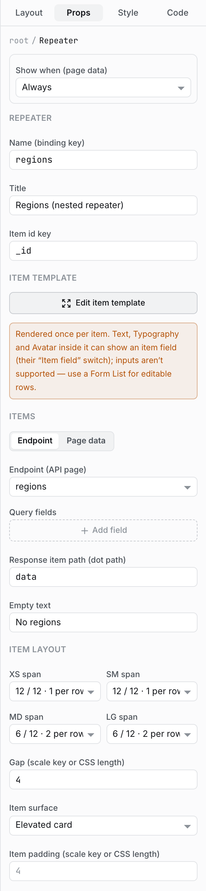

| Section | What it does |
|---|---|
| Items | `Endpoint` (with query fields and the item path) or `Page data` (a load's array). Inside another repeater's template a third source, **Parent item field**, takes an array off the enclosing item, which is how repeaters nest. |
| Item layout | The span of each item per breakpoint (12/12 is one per row, 4/12 three per row), the gap, an optional card surface and its padding. |
| Item click | Open a page when an item is clicked, with `:params` from the item. |

Inside the template, a bound Typography exports its binding as a `row` value:

```json
{
  "type": "typography",
  "element": {
    "text": "Region",
    "variant": "h6",
    "value": { "type": "row", "key": "name" }
  }
}
```

### Display

Text, Typography, Avatar, Divider, HTML and Approval line draw things; none of them is a form field.

#### Typography

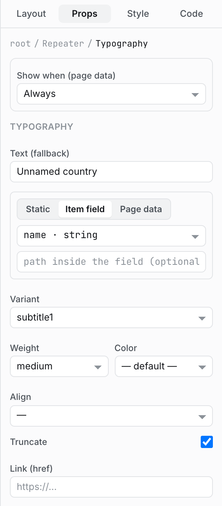

| Field | What it does |
|---|---|
| Text (fallback) | The static text, and the fallback when a binding resolves empty. The switch under it binds it to an item field or page data; `none` is the item itself for arrays of strings. |
| Variant, Weight, Color | `display1`, `h1` to `h6`, `subtitle`, `body`, `caption`, `overline`, `button`; a weight override; a Radix colour. |
| Align, Truncate, Link | Text alignment, single-line ellipsis, and an `href` that makes it a link. |

**Text** is the plain version: a string, optionally drawn as a form label, bindable inside a repeater. **Avatar** is an image with alt text, a size from XS to XL and an initials fallback, both the image and the fallback bindable. **Divider** is a rule with a variant (full width, inset, middle) and spacing.

#### HTML

A block of markup rendered through the same sanitiser as table HTML columns: scripts, `<style>` and form controls are removed, `class`, `style` and links survive, and same-origin links navigate inside the app.

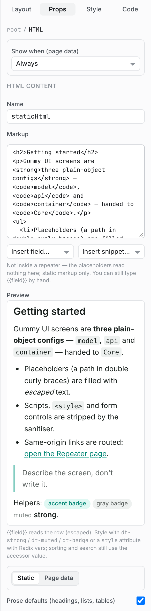

**Markup** is a template: `{{field}}` placeholders read the bound value (inside a repeater, the item), always escaped. **Insert field** and **Insert snippet** (bold value, badges, a link to any page of the project) help write it, and the **Preview** shows the sanitised result. **Prose defaults** turns on the typographic styles for headings, lists and tables.

**Approval line** draws an approval workflow as avatars on a connector with a status badge each. It takes the raw step rows of a document system (from page data, the enclosing repeater item, or its own endpoint) and a set of **row keys**, each a list of paths tried in order, because reviewer rows and approver rows often name their fields differently. Role rules, the status map and the requester slot are configurable.

### Layout

Container, Tab, Paper and Card hold other components in a child canvas. Fields inside them belong to the page's form.

#### Card

A card after Material UI's: header, media band, content, action row, expandable section, and an optional click target.

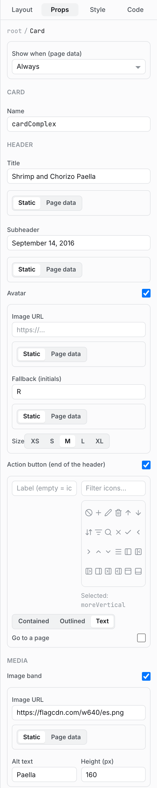

| Section | What it does |
|---|---|
| Header | Title and subheader (static or bound), an avatar with image, initials fallback and size, and an action button at the end of the header (icon, variant, Go to a page). |
| Media | An image band with URL (static or bound), alt text and height. A missing image shows a placeholder. |
| Content | **Edit content** drills into the card's canvas. |
| Actions | A sortable list of footer buttons, aligned start or end. |
| Expandable section | A chevron that opens a second canvas; its toggle label and whether it starts open. |
| Card click | Go to a page when the card itself is clicked (clicks on buttons inside are excluded). |
| Surface | Elevation or outlined, the elevation level, square corners. |

```json
{
  "type": "card",
  "element": {
    "name": "cardComplex",
    "header": {
      "title": "Shrimp and Chorizo Paella",
      "subheader": "September 14, 2016",
      "avatar": { "size": "md", "fallback": "R" },
      "action": { "label": "", "icon": "moreVertical", "variant": "text", "actions": [] }
    },
    "media": { "src": "https://flagcdn.com/w640/es.png", "alt": "Paella", "height": 160 },
    "content": "…canvas…",
    "actions": [
      { "label": "", "icon": "heart", "variant": "text", "actions": [] },
      { "label": "", "icon": "share", "variant": "text", "actions": [] }
    ],
    "collapse": "…canvas…",
    "collapseLabel": "Show method"
  }
}
```

**Container** is a plain grid with its own column count and an optional surface. **Paper** is a container drawn as a surface: elevation or outlined, an elevation level, square corners. **Tab** has one canvas per tab header and a default tab; add and remove tabs from its panel.

### Overlay

Modal, Drawer and Popover open a child canvas over the page. Each mounts its own form, so a Save button inside submits only what is in the overlay, and a **Close modal** action targets it by id.

#### Drawer

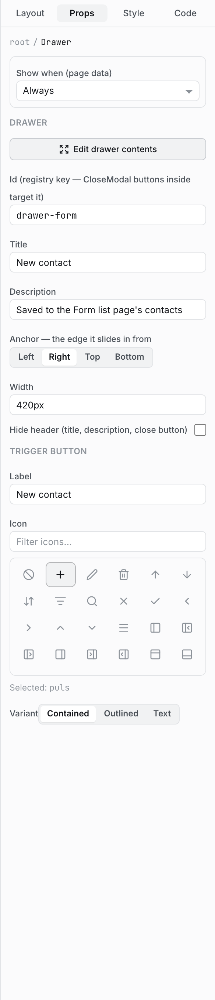

| Field | What it does | Default |
|---|---|---|
| Edit drawer contents | Drills into the drawer's canvas. | |
| Id | The registry key. Close modal buttons inside pick it; an Open modal button elsewhere can open it. | `drawer_n` |
| Title, Description | The header. | |
| Anchor | The edge it slides in from. | Right |
| Width / Height | Its size along that edge, any CSS length. | 360px / 50vh |
| Hide header | Drops the title row (the dialog keeps a hidden name for screen readers). | off |
| Trigger button | Label, icon and variant of the button that opens it. | |

The exported drawer carries its canvas as a `container` and the trigger as a mini-Bin; the Cancel button inside is simply a button with `CloseModal` and `modalId: "drawer-form"`.

A **Modal** has the same panel without the anchor and with maximum and minimum width and a maximum height. A **Popover** floats next to its trigger instead: a placement (top, bottom, left, right, each with a start or end alignment), an offset, opening on click or hover, and a trigger that is either a button or a piece of text.

### Utility: the Button

Buttons carry the **actions**. A click runs a chain of engine actions, optionally behind a confirm dialog.

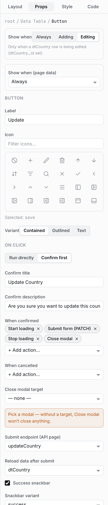

| Section | What it does |
|---|---|
| Label, Icon, Variant | An empty label makes an icon-only button. Variants `Contained`, `Outlined`, `Text`. |
| On click | `Run directly` or `Confirm first` (with a title and description). Then one chain per outcome. |
| Actions | `Start loading`, `Submit form (POST)`, `Submit form (PATCH)`, `Stop loading`, `Clear form selection`, `Close modal`, `Go to page`, `Reload data`, plus every custom action declared on the Env page (`Custom: name`, drawn as an `ƒ` chip). Order matters — drag a chip by its grip to reorder (or focus the grip: Space, arrows, Space); a failed validation stops the chain. |
| Close modal target | Which modal or drawer `Close modal` closes. |
| Submit endpoint | The endpoint a `Submit form` action posts the form to. |
| Reload data after submit | A table, list or repeater name, or a page-data load, refetched after a successful submit. |
| Success snackbar, Show API error as snackbar | Toasts. |
| Navigation | `Go to another page` with `:param` sources (the engine `Navigate` action). |

The Countries form's Update button, which exists only when editing:

```json
{
  "type": "button",
  "condition": { "right": { "key": "dtCountry", "path": "_id" }, "operator": "neq", "left": {} },
  "element": {
    "label": "Update",
    "icon": "save",
    "actions": ["ConfirmBox"],
    "confirmBox": {
      "title": "Update Country",
      "description": "Are you sure you want to update this country?",
      "True": ["StartLoading", "SubmitFormToPatchAPI", "StopLoading", "CloseModal"],
      "False": []
    },
    "api": { "name": "updateCountry" },
    "reloadDataTable": "dtCountry",
    "snackbarSuccess": { "type": "success", "message": "Country updated successfully" },
    "snackbarError": "$exception"
  }
}
```

The `condition` is the `Show when: Editing` control; the confirm chain is the `When confirmed` list.

**Custom actions.** A chain can call code the engine doesn't have. Declare the name on the Env page (say `checkStock`), then add `Custom: checkStock` to the chips — it sits at any position, in both confirm branches too. The export writes it as `"fn:checkStock"`:

```json
{
  "type": "button",
  "element": {
    "label": "Save",
    "actions": ["StartLoading", "fn:checkStock", "SubmitFormToPostAPI", "StopLoading"],
    "api": { "name": "createOrder" }
  }
}
```

and `actions.ts` in the export bundle gets a typed stub for the developer to fill in:

```ts
export const actions: TActionMaster = {
  checkStock: async (ctx) => {
    // TODO: implement "checkStock"
  },
};
```

In the app the function receives the form, the repeater item, the page data, snackbar / loading / navigation and the fn registry; `return false` ends the chain, a throw shows through the error snackbar. The Live Preview has no app code, so it **stubs** every declared action: the chain continues and the call is logged, with the context it would have received, in the dev tools' **Actions** tab. A chip whose declaration was deleted turns amber, exports as `fn:MISSING_ACTION`, and the app skips it with a console warning. The seeded project's **Custom actions** page is the walkthrough: a counter, a guarded Save, a per-item button in a repeater, a confirm with custom branches, and one deleted name.

**Hidden** is a form field that is never drawn, for ids and other values the form must carry. **Empty** is a blank cell for spacing.

---

## For developers

- The studio is `apps/studio` (`@gummy-ui/studio`): Vite 8, React 19, Tailwind 4, zustand. It consumes the library's **built** `dist/`, so rebuild `packages/ui` after changing component source, and do so before starting the studio (see Troubleshooting).
- The architecture (workspace store and migrations, nested canvases, live cell previews, export, Live Preview routing) is documented in the repository's [CLAUDE.md](../../CLAUDE.md) under "Studio", which is the maintained reference. Each feature's studio side is described beside its engine side there.
- `.claude/launch.json` at the repository root has `studio`, `api` and `example` launch configurations that pin a Node 20+ binary.
- The screenshots in `docs/images/` were captured from the seeded project at a 1440px viewport in light mode. [docs/images/README.md](docs/images/README.md) says which page and panel each one shows, for when a panel changes and a picture needs retaking.
